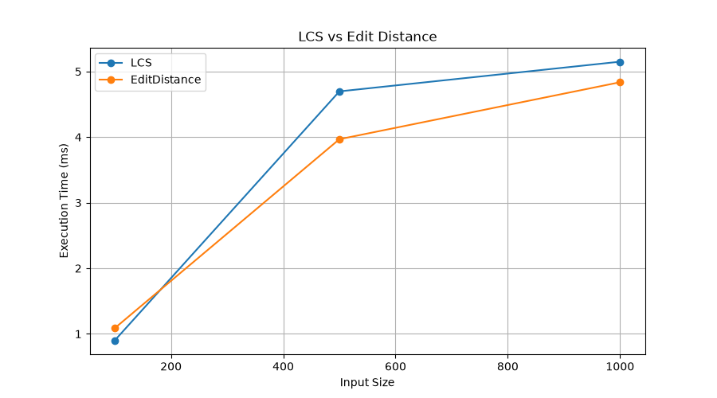
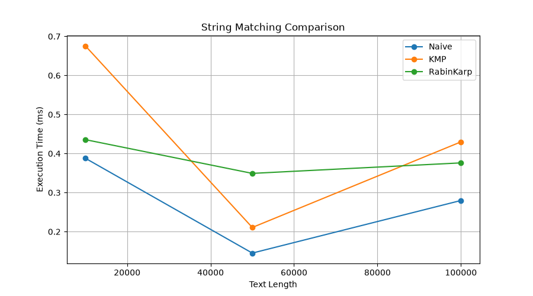

# Assignment 4 - Text Analysis

## 1. Project Description

This project implements text analysis algorithms
using Dynamic Programming and String Matching.

The project includes:

1. Longest Common Subsequence (LCS)
2. Edit Distance
3. Naive String Matching
4. Knuth-Morris-Pratt (KMP)
5. Rabin-Karp
6. Kasai's LCP Algorithm

The main objective is to implement these algorithms,
test their correctness and compare their performance.

## 2. Implementation

### Dynamic Programming

LCS finds the length of the longest common
subsequence between two strings.

Edit Distance calculates the minimum number
of insertions, deletions and substitutions
needed to transform one string into another.

### String Matching

Naive Search checks every possible position.

KMP uses an LPS table to avoid repeated comparisons.

Rabin-Karp uses rolling hash to compare substrings.

### Advanced Algorithm

Kasai builds the LCP array using a string
and its suffix array.

## 3. Complexity Analysis

| Algorithm | Best Time | Worst Time | Space |
|---|---|---|---|
| LCS | O(m*n) | O(m*n) | O(m*n) |
| Edit Distance | O(m*n) | O(m*n) | O(m*n) |
| Naive | O(n) | O(n*m) | O(k) |
| KMP | O(n+m) | O(n+m) | O(m+k) |
| Rabin-Karp | O(n+m) expected | O(n*m) | O(k) |
| Kasai | O(n) | O(n) | O(n) |

Where:

- n = text length
- m = pattern length
- k = number of matches

LCS and Edit Distance use dynamic
programming tables.

KMP uses preprocessing to avoid
unnecessary comparisons.

Rabin-Karp uses hashing and verifies
matches to handle hash collisions.

Kasai uses previously calculated
LCP information to achieve linear time.

## 4. Implementation Decisions

All algorithms are implemented manually.

An empty pattern returns every possible
position from 0 to the text length.

The string matching algorithms return
a list of starting indices.

The suffix array is constructed separately
using the prefix doubling method.

Kasai receives an already constructed
suffix array.

## 5. Testing

The project includes tests for:

- Identical strings
- Different strings
- Empty strings
- Insertions
- Deletions
- Substitutions
- Pattern at the beginning
- Pattern in the middle
- Pattern at the end
- Multiple occurrences
- Pattern absence
- Pattern longer than text
- Empty pattern

All three string matching algorithms
are checked against the same expected results.

Kasai is tested using the string "banana".

Expected suffix array:

[5, 3, 1, 0, 4, 2]

Expected LCP array:

[0, 1, 3, 0, 0, 2]

## 6. Experimental Setup

Java Version: 17

Random Seed: 42

Alphabet: ABCD

Number of Runs: 5

Timing Method: System.nanoTime()

Input sizes:

LCS and Edit Distance:
100, 500, 1000

String Matching:
10000, 50000, 100000

Kasai:
1000, 5000, 10000

The same inputs are used when comparing
algorithms solving the same problem.

Input generation and console output
are excluded from timed regions.

## 7. Experimental Results

Results are saved in results/results.csv.

### Dynamic Programming

### String Matching

## 8. Discussion

LCS and Edit Distance have quadratic
time complexity because they use
two-dimensional dynamic programming.

Naive search may perform many repeated
character comparisons.

KMP improves searching by using
the LPS table.

Rabin-Karp uses rolling hash values
and verifies possible matches.

Kasai calculates the LCP array
in linear time.

Experimental results may differ from
theoretical expectations because of
hardware and JVM optimization.

## 9. Conclusion

This project demonstrates several
important string processing algorithms.

Dynamic Programming solves problems
using previously calculated results.

KMP and Rabin-Karp improve string searching.

Kasai efficiently calculates longest
common prefixes.

The experiments demonstrate the difference
between theoretical complexity and
actual execution time.

## 10. How to Run

1. Open the project in IntelliJ IDEA.
2. Run Main.java.
3. Run AlgorithmTests.java.
4. Run Benchmark.java.
5. Install pandas and matplotlib.
6. Run plot_results.py.